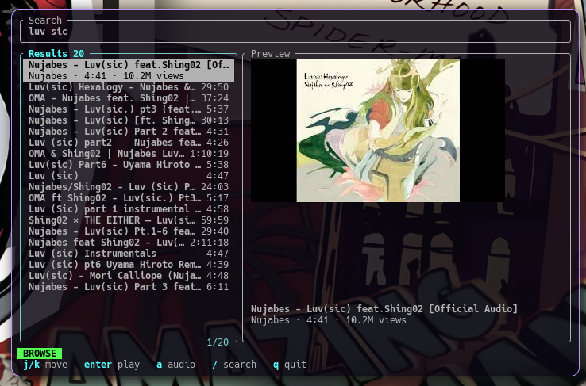

<div align="center">

# ytglide

**YouTube in your terminal, with real thumbnails**

[](https://github.com/ncorrea-13/ytglide/actions/workflows/ci.yml)
[](https://www.rust-lang.org)
[](https://ratatui.rs)
[](https://github.com/ncorrea-13/ytglide/releases)
[](LICENSE)

</div>

---
<p align="center">
  
</p>

A small terminal UI, built with Ratatui and ratatui-image, to search YouTube, preview thumbnails and play videos or audio with [mpv](https://mpv.io/). It is a thin layer over `yt-dlp` (search) and `mpv` (playback), so it needs no API key and no account.

It is a Rust take on the idea behind [ytsurf](https://github.com/Stan-breaks/ytsurf): the same "search, pick, play" flow, but with a built-in interface instead of `fzf` and `chafa`.

This is a personal project. See the [disclaimer](#disclaimer).

## Features

- Search through `yt-dlp` (`ytsearchN:`), no API key needed.
- Thumbnail preview drawn as a real image in terminals that support it (Kitty graphics, Sixel, iTerm2), with a Unicode halfblocks fallback everywhere else.
- Plays video (capped at 720p by default) or audio only.
- Pause, resume and stop from the UI, without leaving it.
- Follows your terminal theme: it sets no background and uses ANSI colors only.
- Narrow terminals (under 90 columns) switch to a single view, toggled with `p`.

## Dependencies

| Program         | Purpose                       |
| --------------- | ----------------------------- |
| `yt-dlp`        | search and stream resolution  |
| `mpv`           | playback                      |
| `curl`          | thumbnail download            |
| Rust toolchain  | building (stable, edition 2024) |

For sharp thumbnails use a terminal with an image protocol (WezTerm, Kitty, Ghostty, foot, iTerm2). Any other terminal still works with halfblocks, just at lower fidelity.

## Install

Download a prebuilt binary (glibc or static musl) from the [Releases](https://github.com/ncorrea-13/ytglide/releases/latest) page and put `ytglide` somewhere in your `PATH`.

Or build it from source:

```sh
git clone https://github.com/ncorrea-13/ytglide
cd ytglide
cargo build --release
install -Dm755 target/release/ytglide ~/.local/bin/ytglide
```

## Usage

```sh
ytglide
```

Type a query and press `enter`. The results appear on the left and the thumbnail of the selected video on the right.

### Keybindings

**Search**

| Key                   | Action                         |
| --------------------- | ------------------------------ |
| `enter`               | run the search                 |
| `esc` / `tab` / `down` | go to the results             |
| `left` / `right`, `home` / `end` (`ctrl+a` / `ctrl+e`) | move the cursor |
| `backspace` / `delete` | delete before / after the cursor |
| `ctrl+w`              | delete the previous word       |
| `ctrl+u`              | clear the query                |
| `up` / `ctrl+p`, `ctrl+n` | previous / next search from history |

**Results**

| Key                | Action                                  |
| ------------------ | --------------------------------------- |
| `j` / `k`, arrows  | move                                    |
| `g` / `G`          | first / last result                     |
| `enter`            | play video                              |
| `a`                | play audio only                         |
| `space`            | pause / resume                          |
| `s`                | stop                                    |
| `H`                | show play history                       |
| `p`                | toggle preview (narrow terminals only)  |
| `/`, `i`, `tab`    | back to the search box                  |
| `q` / `esc`        | quit                                    |

Starting a new video stops the previous one, and quitting ytglide stops whatever is playing.

### Launching it from a shortcut

ytglide has no daemon: a shortcut just opens a terminal that runs it. For example, in WezTerm:

```lua
{
  key = "y",
  mods = "LEADER",
  action = wezterm.action.SpawnCommandInNewWindow({ args = { "ytglide" } }),
}
```

Or from your window manager, with whatever terminal you use:

```sh
wezterm start --class ytglide -- ytglide
```

## Configuration

On first run ytglide creates `~/.config/ytglide/config.json` (or `$XDG_CONFIG_HOME/ytglide/config.json`) with the defaults:

```json
{
  "yt_dlp_cmd": "yt-dlp",
  "mpv_cmd": "mpv",
  "curl_cmd": "curl",
  "results": 20,
  "ytdl_format": "bestvideo[height<=720]+bestaudio/best",
  "history_size": 100
}
```

| Key           | Description                                                                                           |
| ------------- | ----------------------------------------------------------------------------------------------------- |
| `yt_dlp_cmd`  | Command used for searching. Extra words are passed as arguments.                                      |
| `mpv_cmd`     | Command used for playback.                                                                            |
| `curl_cmd`    | Command used to download thumbnails.                                                                  |
| `results`     | Number of results per search.                                                                         |
| `ytdl_format` | yt-dlp format string passed to mpv for video. Without a cap mpv picks the best stream (4K/AV1), which can stutter or drift out of sync on modest hardware. Audio always uses `bestaudio/best`. |
| `history_size` | Entries kept in each history (searches and plays). `0` disables history. Stored as `searches` and `plays.jsonl` next to `config.json`. |

Your own `~/.config/mpv/mpv.conf` still applies on top.

## Notes

- Pausing talks to mpv through a socket at `$XDG_RUNTIME_DIR/ytglide-mpv.sock`. If `XDG_RUNTIME_DIR` is not set, pausing is disabled instead of falling back to a shared directory such as `/tmp`.
- Duration and view count come from `yt-dlp --flat-playlist`, so some results may not show a duration.
- Thumbnails are fetched one at a time when you select a video; neighbours are not prefetched.

## Architecture

Blocking work runs on plain threads and reports back through a channel, so the UI thread never waits on a subprocess.

```
src/
  main.rs        terminal setup and event loop
  config.rs      config.json loading
  history.rs     search and play history files
  yt/            backend: search, thumbnails, playback, pause (yt-dlp / curl / mpv)
  app/           state, key handling, events coming back from threads
  ui/            rendering: search box, results, preview, status bar
```

## Development

```sh
cargo test
cargo clippy --all-targets
```

The tests cover the output parsing, the formatting helpers and basic key handling. The UI itself has no automated tests; check it by running it.

## Disclaimer

ytglide is not affiliated with, endorsed by, or sponsored by YouTube or Google. It only runs `yt-dlp`, `mpv` and `curl` on your machine, and it is provided as is, without warranty. You are responsible for how you use it and for following YouTube's terms of service.

## License

GPL-3.0-or-later. See [LICENSE](LICENSE).
